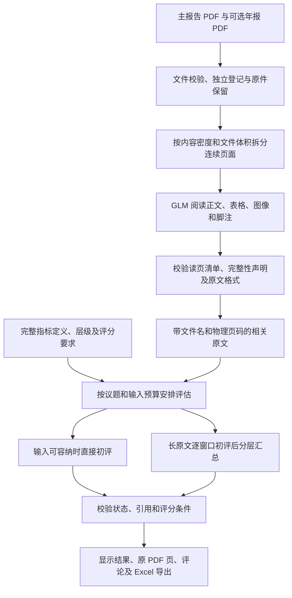

# PDF 识别链路设计与准确性控制

更新日期：2026-10-16。适用项目：MSCI ESG 评级知识库与智能评估工作台。

本文供其他评级、披露分析及长文档评估项目参考，说明本项目已经实现的 PDF 读取、上下文控制、结果校验和缓存设计。代码为实现依据；参数为当前应用默认值，不代表模型服务商的上下文限制或最优参数。

准确性通过保留原文件、逐页调度、明确的输出契约和失败处理来提高。这些工程检查不能保证模型逐字识别无误、没有语义遗漏或判断完全正确。

## 1. 业务目标与总体流程

工作台使用客户上一期可持续发展报告，以及一份可选公司年报，对照完整指标要求，形成已有披露、披露不足和下一年度改进建议。主要报告语言为简体中文，客户以 A 股公司为主。

当前运行流程使用一个 GLM 连接，默认 `glm-5.3-flash`。模型分批读取原 PDF，再评估指标；本机文字层用于页面密度估算和出处辅助处理。原生 PDF 流程不依赖本机语义向量模型或备用 OCR。

读取阶段会提交所选报告的全部物理页，但只保留与所选议题相关的摘录。指标评估使用这些摘录，不是每个指标重新接收整份 PDF，也不是整份报告的逐字转写。

## 2. 先保留原件，再准备读取

实现：[pdf_assessment.py](../pipeline/pdf_assessment.py) 的 `prepare_pdf`，以及 [pdf_pages.py](../pipeline/pdf_pages.py)。

| 控制 | 当前实现 | 目的 |
| --- | --- | --- |
| 文件校验 | 每份最大 30 MiB、1–500 页，拒绝加密或无法打开的 PDF | 在调用模型前发现无效输入 |
| 原文件指纹 | 对原始字节计算 SHA-256 | 标识具体文件内容，支持缓存与来源追踪 |
| 独立文档登记 | 登记标识同时绑定内容指纹和文件名 | 同样内容以不同名称上传时不覆盖原来源名称 |
| 主报告与年报分开 | 分别保留原文件、文件名、来源类型及物理页数 | 年报第 1 页始终是年报的第 1 页 |
| 文字层容错 | 单页或整份文字层读取异常时，仍保留可打开的原 PDF | 扫描件或字体编码异常不因缺少本机文字而被跳过 |
| 上传状态与读完状态分开 | 上传后显示原 PDF 已载入，模型完成后才显示全文已读取 | 避免将文件载入误报成 AI 已完成阅读 |

上传只登记原文件，不调用模型。用户未连接模型时，也可以先上传主报告和年报。

发送给模型的页面使用请求副本，在新增页边距中标明原文件物理页号。原始字节不修改；预览和下载继续使用原件。公司报告的物理页码与 MSCI 方法文件的来源页码分别保存，不能混为同一种引用。

## 3. 阅读阶段：按密度拆批，核对每页是否返回

实现：[pdf_context.py](../pipeline/pdf_context.py) 的 `reading_batches`，以及 [pdf_assessment.py](../pipeline/pdf_assessment.py) 的 `_scan`、`_split_scan`、`_json_call`。

### 3.1 拆批条件

初始调度最多 12 页，页面连续且顺序保留。文字较密时减少页数；没有文字层的页面也计入阅读成本，避免把扫描页当成空白页。当前阅读调度估算预算为 14,000。

模型调用前还检查实际请求 PDF 副本的大小。超过 6 MiB 时先拆小，避免仅凭原文件总大小判断单次请求是否合适。单页仍超过该限制时保留明确失败，不擅自压缩原图或裁掉内容。

文字密度估算不是 PDF 视觉输入的精确分词计量，体积限制也不能证明页面容易识别。这两项用于保守调度。

### 3.2 阅读输出契约

模型须返回 JSON，包括：

- `reviewed_pages`：本批全部原 PDF 物理页号，无相关披露的页也要列出。
- `complete`：是否完整保留本批与所选议题相关的披露。
- `evidence`：原文摘录列表，每条包含物理页号、议题编号和原文。

程序核对页号与本批请求范围完全一致，拒绝缺页、重复页号、错误类型和越界引用。成功输出必须明确返回 `complete: true`。相关内容放不下时，要求返回 `complete: false`。

每批最多 32 条摘录、每条最多 1,200 字。多页批次返回不完整或达到摘录数量边界时，拆成更小的连续页段；模型输出达到上限时也立即拆批。单页输出触顶后，只允许一次更大的输出额度重试，从 8,192 提高到 16,384；仍不完整则失败。

一般格式问题会携带具体错误重试，持续失败的较大批次可继续拆小。接口或网络故障不会触发成倍拆页调用，避免连接故障导致请求量失控。失败的读取不写为成功缓存，也不能继续生成全文未披露结论。

### 3.3 正文、表格与图表如何要求模型读取

读取提示明确覆盖正文、脚注、表格、组织架构和图表，并要求保留直接原文。表格摘录要同时保留行标题、列年度、原始数值、单位和必要统计边界。

提示要求区分空白与 0，不把不同年度、不同单位或不同组织边界的数据合并。跨页表格尽量利用本批可见的上下页表头；禁止用概括性总结替代原文摘录。

这些是模型行为要求，不是表格数值已经自动核验的证明。本轮没有实现专门的跨批次表头拼接器，表格在批次边界断开仍是需要真实样本检查的情况。

## 4. 出处如何保留，如何避免猜页码

每条摘录在程序中附加原文件名、主报告或年报标识、原 PDF 物理页和稳定原文编号。文件名由后端登记信息提供，不依赖模型自写来源名称。

[pdf_pages.py](../pipeline/pdf_pages.py) 的 `align_evidence` 使用同批原文锚点及数字匹配辅助对齐页码。只有程序设定的较强且可区分的匹配条件成立时才调整页号；短语相似、重复文字、匹配并列或没有文字层时保留模型返回的标记页码。

单位修补仅覆盖已实现的窄规则：同一数值在来源文字中只有一个明确能源单位时，可以恢复模型遗漏的“时”后缀，例如将功率单位补回来源中的电量单位。它不会进行数值换算，也不是通用单位或表格校验器。

原页预览在本机根据原始 PDF 渲染，不调用模型；主报告和年报分别预览与下载。用户的人工复核入口仍只需要填写评论。

## 5. 控制长上下文，同时保留完整指标要求

实现：[workbench-core.js](../site/workbench-core.js)、[workbench-requirements.js](../site/workbench-requirements.js)、[pdf_context.py](../pipeline/pdf_context.py) 和 [pdf_assessment.py](../pipeline/pdf_assessment.py)。

### 5.1 指标与报告内容分开处理

指标维护源在 `extract/` 的 JSON 文件中，生成的网页数据在 `site/data/`。`aiRequirementsForIssues` 根据所选议题构建完整评估要求，包含中文及英文定义、上级指标、评分规则、方法来源页码及数值标尺标记。

当前共 33 个议题、576 项指标；默认治理 6 个议题、107 项。`site/data/ai-requirements.json` 是由同一函数生成的维护与回归检查快照，不是另外一份手工维护的标准，也不是客户报告。

方法字段过长时明确失败，不截断后发送。当前 576 项方法数据已经验证：经过服务端校验后，其指标字段保持不变。

### 5.2 共享重复字段

同批指标相同的议题名称、类型等字段放进 `shared`，单项保留不同字段。将共同字段与单项字段合并后，应能还原完整要求。这样减少重复输入，不靠删掉定义节省用量。

请求中用 `C1`、`C2` 表示指标，用 `E1`、`E2` 表示原文，降低模型抄错长编号的概率。返回后程序还原为稳定编号。临时别名不是永久指标身份。

### 5.3 长原文分窗口，而不是只取前几段

| 调度层级 | 当前限制 |
| --- | --- |
| 按议题组织的外层指标组 | 最多 16 项，之后还会拆分 |
| 实际单次评估 | 最多 8 项，并受完整输入预算约束 |
| 普通输入估算预算 | 12,000 |
| 窗口结果汇总估算预算 | 28,000 |
| 最终单项引用 | 最多 8 条直接依据 |

预算包括完整要求、项目背景、相关原文及提示开销；调用前还会检查实际文本输入估算。估算采用本机字符启发式规则，不是服务商分词器，也不是费用上限。

原文过多时，按顺序划分多个窗口，所选议题原文池中的每条摘录都会被安排进窗口，不按相关度排名直接丢掉尾部。多个指标在预算允许时共享窗口，减少重复发送。

某一窗口的“未找到”只对该窗口有效。所有窗口完成后才允许形成全文层面的最终结果。只要窗口没有完成，就不能因为剩余窗口没有材料而写成“未披露”。

### 5.4 分层汇总

同一指标的窗口结果两两合并，汇总携带前序结论及其引用的原始摘录，继续对照完整要求。提示要求保留矛盾、年度和统计边界，不能投票决定状态；一个窗口缺少的条件可能被另一个窗口补齐。

汇总并不重新发送全部原文，最终引用数量也有限。因此，“每个窗口都处理过”不能证明最终说明保留了所有细节。模型最初漏摘、分错议题或汇总遗漏的信息，不能仅靠后续格式校验发现。

## 6. 输出校验：阻止无效结果进入成功状态

模型请求使用 JSON 输出模式，同时在本机验证返回内容。只要求 JSON 并不足以获得可靠结论。

| 校验 | 不满足时的处理 |
| --- | --- |
| 输出完整结束且可解析 | 输出截断或格式错误保留失败、按规则重试 |
| 指标编号存在且不重复 | 仅重试遗漏或非法的指标，保留有效结果 |
| 状态属于允许的集合 | 拒绝未知状态 |
| 引用编号属于本次输入 | 拒绝自编或越界的引用编号 |
| 已披露、部分披露或矛盾有引用 | 没有原文出处则不能视为有效结果 |
| 未披露没有引用 | 拒绝“未披露”却同时携带引用的自相矛盾结果 |
| 没有数值标尺标记时分数为空 | 拒绝在此条件下生成建议分数 |
| 说明与引用数量受限 | 过长结果要求简明重试，不在程序中静默截断 |

主要说明建议约 150 字；程序对单项说明字段设置 800 字上限，对分数字符串设置 80 字上限。输出额度按待处理指标数调整，避免无限制长篇输出。

这些检查验证格式、编号和基本一致性，不证明引用语义充分，也不复算所有 MSCI 评分公式及取值范围。当前结果中的 `confidence: medium` 是固定标签，不能当成经过校准的识别正确率。

## 7. 缓存与版本控制

实现：[review_cache.py](../pipeline/review_cache.py)。

读取缓存绑定读取版本、原文件内容、文件名、主报告或年报来源、服务地址、模型、所选议题与页段。初评缓存另外绑定完整指标、原文、项目背景、评估模式及汇总输入。

只有满足校验条件的完整读取或完整评估组才按成功结果缓存。读取缓存与初评缓存分开保存，写入采用临时文件替换；文件权限限制为本机用户访问。密钥不进入缓存键或缓存内容，只保留在服务进程内存。

| 项目 | 当前值 |
| --- | --- |
| 读取契约 | `native-pdf-review-v2` |
| 初评契约 | `native-assessment-v3` |
| 读取磁盘缓存上限 | 120 个批次 |
| 初评磁盘缓存上限 | 150 组 |
| 本机接口版本 | 6 |

提示、摘录契约或判断规则改变时，应更新对应版本，防止把旧结果当成新规则下的结果。新契约不直接复用旧提示缓存，首次运行可能产生新用量；缓存被清理、淘汰或输入变化也可能重新调用模型，不能承诺所有重跑都没有费用。

## 8. 运行检查原则

发布前按变动范围核对页段覆盖、独立文件与页码、窗口完整性、失败重试、缓存版本、完整指标、评论保存与 Excel 导出。来源审计核对 37 份方法 PDF 的指纹、结构和来源字段；这些检查不能证明所有模型判断正确。

真实模型检查使用获授权的公开资料，记录实际调用与用量。代码或模拟检查不写成真实模型、真实浏览器或全部指标的精度认证。测试脚本、原始报告和检查输出在仓库外保存。

## 9. 其他项目复用时的顺序

1. 先定义文档身份、来源类型和物理页码，再接模型；保留可预览的原件。
2. 明确完整指标的数据结构，保留原始定义、数值规则和版本，不在每次调用时临时生成标准。
3. 将读页与评级拆开，建立页段、完整性声明和失败状态；不要把传输故障写成未披露。
4. 在输入预算内处理完整方法与原文；超过预算就拆批，保留全部窗口的调度记录。
5. 验证输出编号、引用和状态约束，并区分工程校验与语义准确性。
6. 用含尾部披露、扫描表格、跨页表头、单位差异、年度差异和矛盾材料的公开样本做真实模型验收，再调整预算与提示。

迁移到其他模型时，需要重新核实文件消息格式、JSON 输出支持、输出终止原因及用量字段，不能只替换模型名称。上面的参数应按真实报告重新验证。
